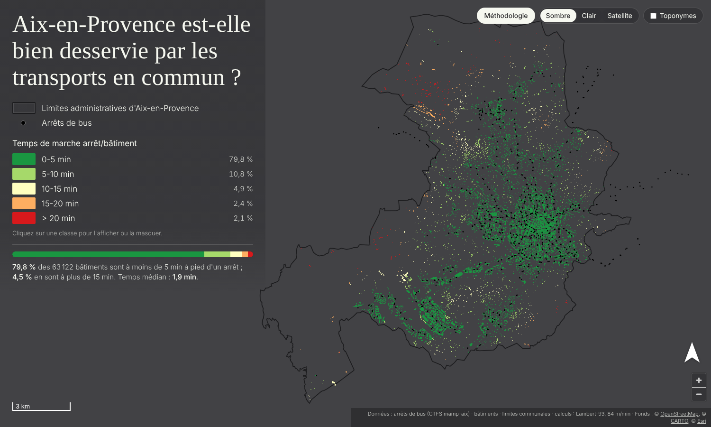

# Aix-en-Provence est-elle bien desservie par les transports en commun ?

Carte interactive (webmapping) du **temps de marche entre chaque bâtiment d'Aix-en-Provence et l'arrêt de bus le plus proche** : 63 122 bâtiments, 883 arrêts.



## Résultats

| Temps de marche | Bâtiments | Part | Part de l'emprise bâtie |
|---|---:|---:|---:|
| 0-5 min | 50 377 | 79,8 % | 84,3 % |
| 5-10 min | 6 787 | 10,8 % | 8,2 % |
| 10-15 min | 3 099 | 4,9 % | 4,0 % |
| 15-20 min | 1 529 | 2,4 % | 2,1 % |
| > 20 min | 1 330 | 2,1 % | 1,5 % |

Temps médian : 1,9 min · temps moyen : 3,7 min.

## Fonctionnalités

- Même sémiologie que la carte statique : fond gris foncé, palette rouge-jaune-vert (5 classes), arrêts en points noirs, contour communal sombre, échelle, flèche du nord, titre en Caprasimo (équivalent libre de Cooper Black) et texte en Barlow.
- Légende interactive : un clic sur une classe l'affiche ou la masque.
- Clic sur un bâtiment : temps, distance et arrêt le plus proche (mis en évidence).
- Trois fonds : gris uni, satellite en niveaux de gris (par défaut, pour faire ressortir les couleurs) et satellite en couleur (Esri World Imagery).
- Section **Méthodologie** intégrée (bouton en haut à droite, ou `index.html#methodologie`).
- Adapté au mobile. Aucune dépendance de build : HTML + CSS + JS, MapLibre GL JS embarqué dans `lib/`.

## Publier sur GitHub Pages

1. Créez un dépôt et poussez le contenu de ce dossier (le fichier `data/batiments.geojson` fait ~16 Mo, soit ~2,4 Mo une fois compressé par GitHub Pages ; la limite de GitHub est de 100 Mo par fichier).
2. *Settings → Pages → Deploy from a branch → `main` / `(root)`*.
3. La carte est en ligne à `https://<utilisateur>.github.io/<depot>/`.

Pour tester en local : `python -m http.server 8000` puis http://localhost:8000 (le fichier ne fonctionne pas en `file://` à cause du chargement des GeoJSON).

## Structure

```
index.html            page, légende et texte de la méthodologie
css/style.css         styles
js/app.js             carte (MapLibre GL JS), interactions
lib/                  MapLibre GL JS 4.7.1 (licence BSD-3)
data/                 batiments / arrets / limites (GeoJSON WGS84) + stats.json
scripts/build_data.py recalcule les données à partir des shapefiles
docs/                 document de méthodologie d'origine (.docx)
```

## Méthodologie (résumé)

1. **Reprojection** de toutes les couches en RGF93 / Lambert-93 (EPSG:2154, mètres).
2. **Arrêt le plus proche** de chaque bâtiment grâce à un index spatial (STRtree / `sindex`) ; distance euclidienne entre le bord du bâtiment et l'arrêt.
3. **Temps de marche** = distance ÷ 84 m/min (≈ 5 km/h).
4. **Classes** : 0-5, 5-10, 10-15, 15-20, > 20 min (bornes supérieures incluses, comme `pd.cut`).

Le script `scripts/build_data.py` reproduit ces étapes et retrouve exactement les valeurs du projet QGIS d'origine.

```bash
pip install geopandas pyogrio shapely
python scripts/build_data.py <dossier_shapefiles> data
```

### Limites

Distance à vol d'oiseau (et non sur le réseau piéton) ; desserte théorique sans fréquence ni horaires ; un bâtiment n'est pas un habitant ; vitesse de marche unique.

## Crédits

Arrêts : GTFS *mamp-aix*, Réseau urbain de la métropole Aix-Marseille · Bâtiments et limites communales : BD TOPO IGN · Fonds : Esri, Maxar, Earthstar Geographics · Carte : MapLibre GL JS.
